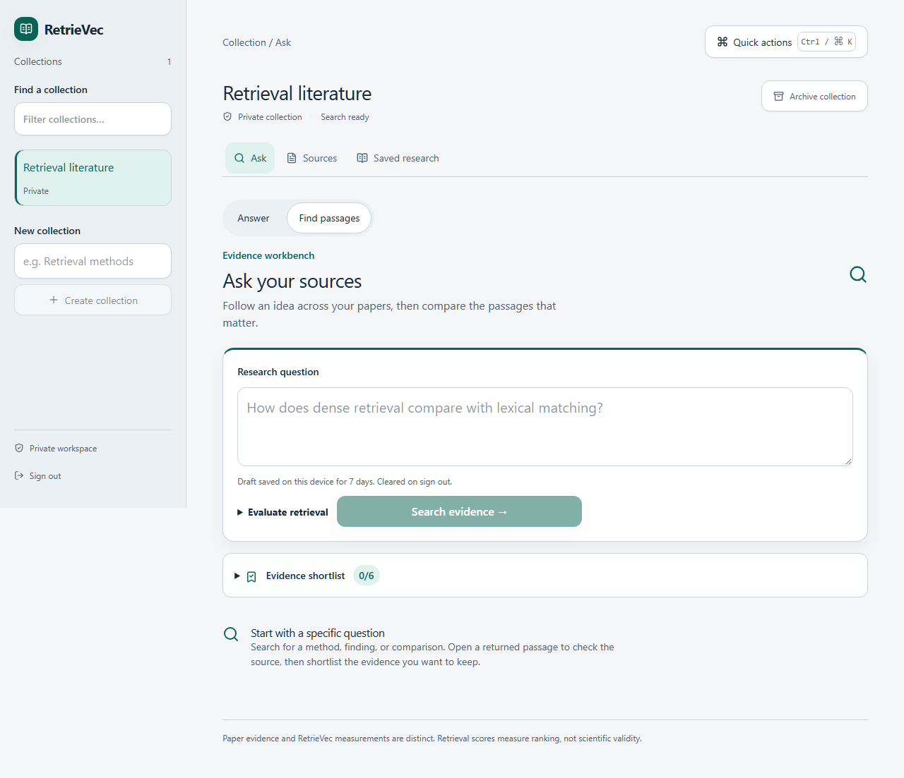

# RetrieVec

### Your papers. Traceable evidence.

A private research workspace to **find passages, inspect sources, and save cited
answers**—with the question, model and source snapshot kept together.



*The local demo searches retained SciFact abstracts. This screenshot shows real
retrieval, not generated answers or a model-quality claim.*

## Try it in 2 minutes

**You need:** Git, Docker Desktop with Linux containers (or Docker Engine with
the Compose plugin on Linux), an internet connection for the first build, and
free local ports **8000** and **8080**. No host Python, Go, Node, database or
language model setup is needed for this demo.

Get the project, then check that Docker is running. Skip the clone if you already
have this checkout; run the remaining commands from its root:

```sh
git clone https://github.com/VEDLEGENDARY/RetrieVec.git
cd RetrieVec
docker info
docker compose version
```

Start the app, database and local sign-in service:

```sh
docker compose -f compose.demo.yaml --profile demo up --build -d
```

Open **http://127.0.0.1:8000**, choose **Sign in**, then **Register** to create
your local account. The **SciFact starter** collection is already loaded: ask
about “cancer” in **Find passages**, then inspect a result or build a shortlist.

The two-minute path assumes cached images and model files. The first run builds
the app and downloads its pinned MiniLM retrieval model; allow additional time
and an internet connection. Keycloak may need a few seconds after startup.
Ports 8000 and 8080 must be free; use `127.0.0.1` consistently.

The demo includes 24 title/abstract records, no paper PDFs and no generation
provider. It generates credentials into local Docker volumes; no preset password
or cloud consent is included. Create a private collection to upload your papers.
In **Sources**, choose text or PDF files, submit the upload, and wait for processing
to finish before searching. Scanned PDFs need a separate OCR/extraction workflow.

### Check startup, stop and return later

```sh
docker compose -f compose.demo.yaml --profile demo ps
docker compose -f compose.demo.yaml --profile demo logs --tail=100 workspace identity
```

Wait for the workspace to become healthy, then open the browser. The API health
endpoint is **http://127.0.0.1:8000/healthz**; a successful health response does not
replace the browser sign-in check.

```sh
docker compose -f compose.demo.yaml --profile demo down
```

Stopping keeps your volumes and account. Run the original `up --build -d` command
to return later. Avoid `down --volumes` unless you intend to delete your local
database, accounts, retained sources and model cache.

| If you get stuck | What to do |
|---|---|
| Docker cannot connect | Start Docker Desktop/Engine; on Windows select Linux containers, then retry `docker info`. |
| A port is already allocated | Stop the process using 8000/8080, then retry startup. Changing these ports also requires matching OIDC URLs. |
| The app or sign-in is not ready | Check `ps` and the logs above. Allow the first model download and Keycloak startup to finish; retry the same `up` command if a download failed. |
| Sign-in redirects fail | Open `http://127.0.0.1:8000` consistently, including registration; do not switch between `localhost` and `127.0.0.1`. |
| Answer mode is unavailable | This demo has no generation provider. Passage search works immediately; configure generation separately as described below. |

For deployment, identity configuration,
backups, tracing, pgvector, Kubernetes, OpenTofu and mTLS, see
[operations](docs/OPERATIONS.md).

### Want generated cited answers?

Generation is optional. The demo does **not** download Qwen or start a language
model server. Use the [generation setup](docs/OPERATIONS.md#optional-generation)
to configure a pinned llama.cpp-compatible provider and give the API/research
worker the same configuration. A server running on your host is not the
container's `127.0.0.1`; its endpoint must be reachable from the worker. Do not
paste the local example endpoint unchanged into a container deployment.
Cloud providers require explicit consent for each collection. Once configured,
select **Answer** in Ask and check its model/provider indicator before submitting.

## A workspace built around evidence

| Destination | What you can do |
|---|---|
| **Ask** | Switch between cited answers and passage search; inspect what each answer used. |
| **Sources** | Upload text/PDFs, track ingestion, retain source hashes and provenance. |
| **Saved research** | Return to a run, its model and immutable snapshot; export cited results. |

- **Verify before trusting.** Inspect retained passages, source metadata and
  supported PDF highlights. Missing coordinates are explained, never guessed.
- **Compare papers.** Shortlist passages and compare them in a table where
  every data cell cites its source. Export the evidence with its snapshot.
- **Stay in control.** Local generation is optional; cloud providers require
  explicit collection consent. Sign-in, ownership and scope checks protect access.
- **Keep experiments explicit.** Section-aware chunking, reranking, fusion and
  approximate vector search are opt-in. Retrieval scores are not confidence.

Use **Ctrl/⌘ K** for quick actions and **Ctrl/⌘ Enter** to submit either Ask mode.
Keyboard focus, Escape, dark mode and reduced motion are covered by browser tests.

## Measured, with limits

<!-- BEIR RESULTS START -->

| Corpus | Hybrid nDCG@10 | Warm retrieval p50 |
|---|---:|---:|
| SciFact | 0.6670 | 255.35 ms |
| SCIDOCS | 0.1928 | 897.29 ms |

Source: [docs/results/benchmark-2026-10-05-phase3.json.gz](docs/results/benchmark-2026-10-05-phase3.json.gz). Warm local retrieval excludes HTTP, authorization and database work.

<!-- BEIR RESULTS END -->

These are complete BEIR title/abstract corpora and held-out retrieval judgments,
not full-paper answer evaluations. The benchmark's opt-in lossless wordpiece
refinement differs from the product's default PDF upload chunking. No tuning was
performed on test queries. See [protocol, all variants and rejected configurations](BENCHMARKS.md).

The cross-encoder improved SciFact but reduced SCIDOCS quality; it remains opt-in.
Section boundaries did not establish a retrieval improvement. In the local
Qwen2.5 1.5B run, **11 of 60 cases completed; 49 failed**. Those questions are
synthetic and automatic-only; semantic accuracy is unmeasured, human review is
blank, and NLI was **NOT run**. See [answer evaluation](ANSWER_EVAL.md).

## Build and contribute

Go owns retrieval; Python owns ingest, workers and FastAPI; React owns the web
workspace. PostgreSQL holds application state; immutable artifacts retain evidence.

For native development, install Python 3.13, Go 1.26, Node 24 and PostgreSQL 18.
Create and activate a virtual environment first:

```powershell
# Windows PowerShell
py -3.13 -m venv .venv
.\.venv\Scripts\Activate.ps1
```

```sh
# Linux/macOS (with Python 3.13 installed)
python3.13 -m venv .venv
. .venv/bin/activate
```

Then, from the repository root:

```sh
python -m pip install -r python/requirements-dev.txt
python -m pip install --no-build-isolation --no-deps -e ./python
python scripts/check.py
cd web
npm ci
npx playwright install chromium
npm run build
npm run test:ui -- --workers=2
cd ..
```

These commands build and test the project; they do not start the native app.
Follow [Run the native workspace](docs/OPERATIONS.md#run-the-native-workspace)
to configure database credentials, Keycloak, RPC tokens, the built frontend and
both workers, then start the API. Native Keycloak uses generated development
accounts rather than the demo's registration flow. Stop the Docker demo first
if it is using ports 8000/8080.

Database integrations require isolated test DSNs; see [verification setup](docs/releases/verification.md).
UI tests use labeled synthetic HTTP fixtures. They complement real-service checks.
Work on focused branches and reviewed PRs; retain separate descriptive commits.
Keep weights, PDFs, credentials and private data outside Git.

| Explore | Link |
|---|---|
| Design and navigation | [Audit](docs/design/AUDIT.md) · [Core flows](docs/design/CORE_FLOWS.md) · [Performance](docs/design/PERF.md) |
| Provenance extensions | [Sections, metadata, PDF locations and comparison](docs/design/PHASE5.md) |
| Under the hood | [Architecture and operations](docs/OPERATIONS.md#architecture) |
| Release | [Changelog](CHANGELOG.md) · [v0.1.0 candidate](docs/releases/v0.1.0.md) · [Verification](docs/releases/verification.md) |
