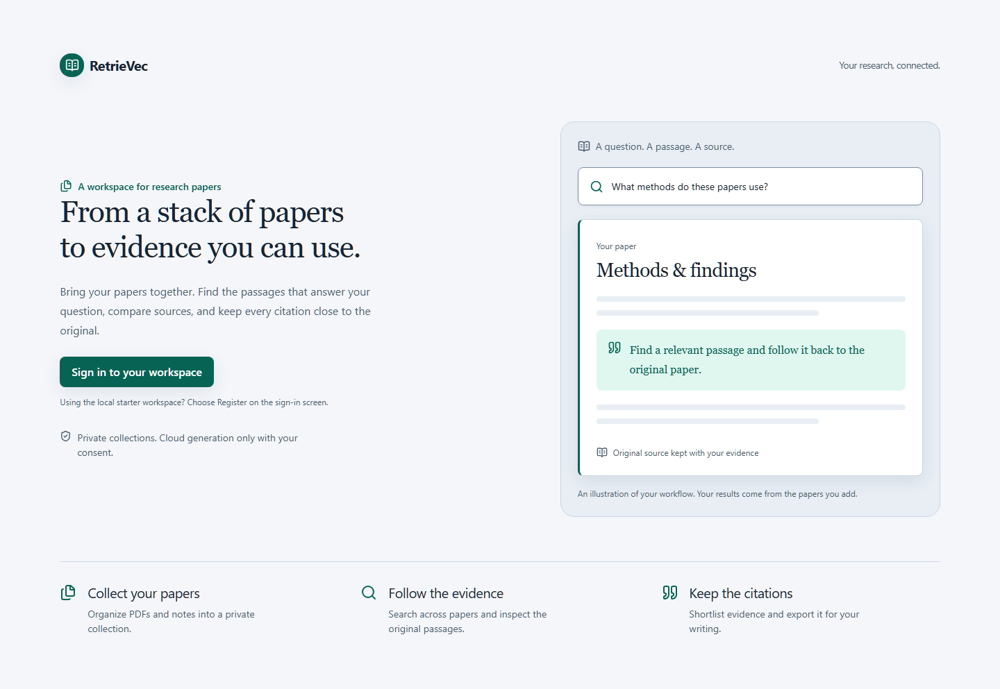

# RetrieVec

### Your papers. Traceable evidence.

A private research workspace to **find passages, inspect sources, and save cited
answers**—with the question, model and source snapshot kept together.



*A paper-first workspace for collecting sources, finding passages, and keeping citations.*

## Start your paper workspace

**You need:** Git and Docker Desktop with Linux containers, or Docker Engine with
Compose 2.20+ on Linux. No host Python, Go, Node, database, or language model setup
is needed. The first build and retrieval model download need internet access and
may take several minutes. Keep local ports **8000** and **8080** free.

```sh
git clone https://github.com/VEDLEGENDARY/RetrieVec.git
cd RetrieVec
```

Start Docker, then run the launcher for your system:

| Windows PowerShell | macOS / Linux |
|---|---|
| `.\start.ps1` | `sh start.sh` |

Or use Docker directly:

```sh
docker compose up --build --wait --wait-timeout 900
```

The default stack builds the app, creates local credentials, starts the database
and sign-in service, and preloads **24 SciFact abstracts**. The launcher checks
prerequisites and waits for services to be ready. It preserves the existing
starter volumes when upgrading.

Open [**your workspace**](http://127.0.0.1:8000), choose **Sign in**, then
**Register** to create your local account. Use `127.0.0.1` consistently.

1. Try **SciFact starter → Ask → Find passages** with `cancer`.
2. Create a private collection for your literature review. It opens **Sources**.
3. Drop in your research PDFs or notes, review the selection, then upload.
4. After processing, choose **Search your papers**. Inspect passages, open
   originals, and build an evidence shortlist for export.

Use **Research guide** in the sidebar for workflow help and shortcuts. Upload
unencrypted PDFs with selectable text, plain text, or Markdown: up to 10 files,
25 MiB each, and 100 pages per PDF. Apply OCR to scanned papers first. The starter
collection contains abstracts, with no full-paper PDFs or generation provider.

| Task | Windows PowerShell | macOS / Linux |
|---|---|---|
| Check setup | `.\start.ps1 doctor` | `sh start.sh doctor` |
| See status | `.\start.ps1 status` | `sh start.sh status` |
| Read logs | `.\start.ps1 logs` | `sh start.sh logs` |
| Stop and keep data | `.\start.ps1 stop` | `sh start.sh stop` |

Run the start command again to resume. Stopping preserves papers, accounts, and
model cache. Avoid `docker compose down --volumes` unless you intend to delete
them. For setup failures, slow downloads, PowerShell policy restrictions, and
first-use instructions, see [the getting started guide](docs/GETTING_STARTED.md).

### Optional generated answers

Passage search works without an answer provider. For cited generation, follow
[the generation setup](docs/OPERATIONS.md#optional-generation), then choose
**Answer** in Ask. Cloud providers require explicit consent per collection.
Local providers in Docker must share the worker's network namespace; a host
server's loopback address is not the container's loopback address.

For native development, deployment, backups, and identity configuration, see
[operations](docs/OPERATIONS.md). Native developers now use
`compose.database.yaml` for the database-only stack.

## A workspace built around evidence

| Destination | What you can do |
|---|---|
| **Ask** | Switch between cited answers and passage search; inspect what each answer used. |
| **Sources** | Upload papers, browse and filter your library, track processing, and open originals. |
| **Saved research** | Return to a run, its model and immutable snapshot; export cited results. |

- **Verify before trusting.** Inspect retained passages, source metadata and
  supported PDF highlights. Missing coordinates are explained, never guessed.
- **Compare papers.** Shortlist passages and compare them in a table where
  every data cell cites its source. Export the evidence with its snapshot.
- **Stay in control.** Local generation is optional; cloud providers require
  explicit collection consent. Sign-in, ownership and scope checks protect access.
- **Keep experiments explicit.** Section-aware chunking, reranking, fusion and
  approximate vector search are opt-in. Retrieval scores are not confidence.

Use **Ctrl/⌘ K** for quick actions and **Ctrl/⌘ Enter** to submit either Ask mode.
Keyboard focus, Escape, dark mode and reduced motion are covered by browser tests.

## Measured, with limits

<!-- BEIR RESULTS START -->

| Corpus | Hybrid nDCG@10 | Warm retrieval p50 |
|---|---:|---:|
| SciFact | 0.6670 | 255.35 ms |
| SCIDOCS | 0.1928 | 897.29 ms |

Source: [docs/results/benchmark-2026-10-05-phase3.json.gz](docs/results/benchmark-2026-10-05-phase3.json.gz). Warm local retrieval excludes HTTP, authorization and database work.

<!-- BEIR RESULTS END -->

These are complete BEIR title/abstract corpora and held-out retrieval judgments,
not full-paper answer evaluations. The benchmark's opt-in lossless wordpiece
refinement differs from the product's default PDF upload chunking. No tuning was
performed on test queries. See [protocol, all variants and rejected configurations](BENCHMARKS.md).

The cross-encoder improved SciFact but reduced SCIDOCS quality; it remains opt-in.
Section boundaries did not establish a retrieval improvement. In the local
Qwen2.5 1.5B run, **11 of 60 cases completed; 49 failed**. Those questions are
synthetic and automatic-only; semantic accuracy is unmeasured, human review is
blank, and NLI was **NOT run**. See [answer evaluation](ANSWER_EVAL.md).

## Build and contribute

Go owns retrieval; Python owns ingest, workers and FastAPI; React owns the web
workspace. PostgreSQL holds application state; immutable artifacts retain evidence.

For native development, install Python 3.13, Go 1.26, Node 24 and PostgreSQL 18.
Create and activate a virtual environment first:

```powershell
# Windows PowerShell
py -3.13 -m venv .venv
.\.venv\Scripts\Activate.ps1
```

```sh
# Linux/macOS (with Python 3.13 installed)
python3.13 -m venv .venv
. .venv/bin/activate
```

Then, from the repository root:

```sh
python -m pip install -r python/requirements-dev.txt
python -m pip install --no-build-isolation --no-deps -e ./python
python scripts/check.py
cd web
npm ci
npx playwright install chromium
npm run build
npm run test:ui -- --workers=2
cd ..
```

These commands build and test the project; they do not start the native app.
Follow [Run the native workspace](docs/OPERATIONS.md#run-the-native-workspace)
to configure database credentials, Keycloak, RPC tokens, the built frontend and
both workers, then start the API. Native Keycloak uses generated development
accounts rather than the demo's registration flow. Stop the Docker demo first
if it is using ports 8000/8080.

Database integrations require isolated test DSNs; see [verification setup](docs/releases/verification.md).
UI tests use labeled synthetic HTTP fixtures. They complement real-service checks.
Work on focused branches and reviewed PRs; retain separate descriptive commits.
Keep weights, PDFs, credentials and private data outside Git.

| Explore | Link |
|---|---|
| Design and navigation | [Audit](docs/design/AUDIT.md) · [Core flows](docs/design/CORE_FLOWS.md) · [Performance](docs/design/PERF.md) |
| Provenance extensions | [Sections, metadata, PDF locations and comparison](docs/design/PHASE5.md) |
| Under the hood | [Architecture and operations](docs/OPERATIONS.md#architecture) |
| Release | [Changelog](CHANGELOG.md) · [v0.1.0 candidate](docs/releases/v0.1.0.md) · [Verification](docs/releases/verification.md) |
